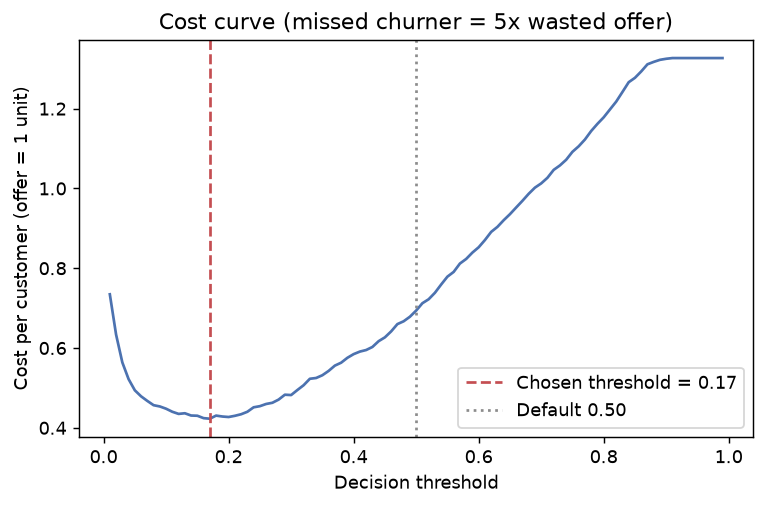
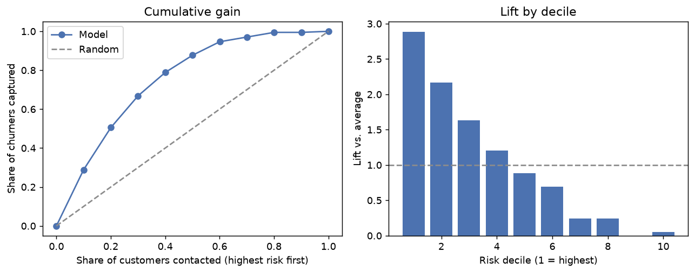
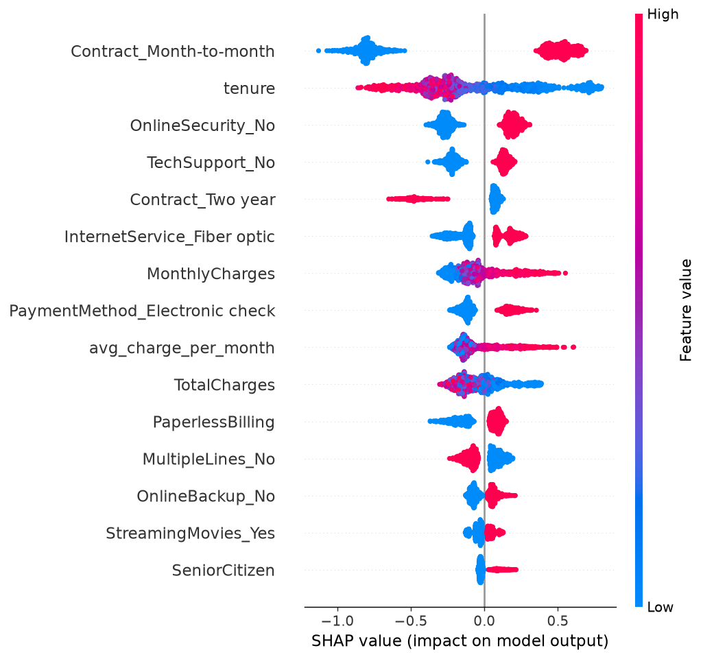

# Customer Churn Prediction

End-to-end machine learning project that predicts which telecom customers will churn, handles the class imbalance properly, picks a decision threshold from a business cost assumption, explains predictions with SHAP, and ships a Streamlit app.

> **Screenshot:** _add `reports/figures/app_screenshot.png` here after running the app locally._
> ``

## Dataset

[IBM Telco Customer Churn](https://github.com/IBM/telco-customer-churn-on-icp4d) sample: 7,043 customers, 20 features, 26.5% churned. `src/data.py` downloads it to `data/raw/telco_churn.csv` (already committed). Cleaning: `TotalCharges` has 11 blank strings, all for customers with tenure 0 (not billed yet), so they are set to 0; `customerID` is dropped; `Churn` is mapped to 0/1.

## Approach

1. **EDA** ([notebooks/01_eda.ipynb](notebooks/01_eda.ipynb)) with a written insight under every chart.
2. **Features** (`src/features.py`): tenure buckets, number of subscribed services, average charge per month of tenure, has-support-services flag, auto-pay flag; one-hot encoding for nominal columns; scaling only for logistic regression. Everything sits inside one sklearn `Pipeline`/`ColumnTransformer`, so nothing is learned from test or validation folds.
3. **Modeling** (`src/train.py`): stratified 80/20 split, stratified 5-fold CV on the training set. Logistic Regression and Random Forest baselines, XGBoost and LightGBM as main models, each with three imbalance strategies: none, class weights / `scale_pos_weight`, and SMOTE (applied only inside the CV pipeline via `imblearn`). The two boosted models are then tuned with `RandomizedSearchCV` (12 candidates, PR-AUC). The final model is chosen by **CV PR-AUC only**; the test set is never used for selection.
4. **Threshold** chosen on out-of-fold training predictions by minimizing expected cost, assuming a missed churner costs **5x** a wasted retention offer.
5. **Evaluation** (`src/evaluate.py`): confusion matrix, ROC and PR curves, calibration, lift/gain, cost curve, SHAP summary and a single-customer SHAP waterfall, plus recall by customer segment.

Accuracy is not used to judge models. A model that predicts "stays" for everyone is 73.5% accurate and finds zero churners.

## Results

Held-out test set (1,409 customers, 374 churners). Recall, precision and F1 are at the default 0.5 threshold, so they show what each imbalance strategy does to the model; PR-AUC and ROC-AUC do not depend on a threshold.

| Model | Imbalance strategy | CV PR-AUC | Test PR-AUC | Test ROC-AUC | Recall | Precision | F1 |
|---|---|---|---|---|---|---|---|
| Logistic Regression | none | 0.662 | 0.651 | 0.845 | 0.52 | 0.66 | 0.58 |
| Logistic Regression | class_weight | 0.660 | 0.651 | 0.845 | 0.80 | 0.51 | 0.63 |
| Logistic Regression | smote | 0.635 | 0.636 | 0.833 | 0.75 | 0.51 | 0.60 |
| Random Forest | none | 0.660 | 0.651 | 0.841 | 0.51 | 0.66 | 0.58 |
| Random Forest | class_weight | 0.658 | 0.648 | 0.841 | 0.77 | 0.53 | 0.63 |
| Random Forest | smote | 0.636 | 0.642 | 0.837 | 0.60 | 0.58 | 0.59 |
| XGBoost | none | 0.664 | 0.663 | 0.845 | 0.53 | 0.66 | 0.59 |
| XGBoost | class_weight | 0.663 | 0.667 | 0.845 | 0.78 | 0.52 | 0.63 |
| XGBoost | smote | 0.655 | 0.661 | 0.844 | 0.59 | 0.60 | 0.59 |
| LightGBM | none | 0.653 | 0.651 | 0.841 | 0.52 | 0.65 | 0.58 |
| LightGBM | class_weight | 0.655 | 0.649 | 0.840 | 0.76 | 0.53 | 0.62 |
| LightGBM | smote | 0.646 | 0.656 | 0.838 | 0.56 | 0.62 | 0.59 |
| **XGBoost (tuned)** | none | **0.670** | 0.661 | 0.848 | 0.53 | 0.67 | 0.59 |
| LightGBM (tuned) | class_weight | 0.667 | 0.666 | 0.848 | 0.80 | 0.53 | 0.64 |

**Selected model:** tuned XGBoost with no resampling (highest CV PR-AUC). With the cost-tuned threshold of **0.17**, on the test set:

| Metric | Value |
|---|---|
| Recall | 0.88 (328 of 374 churners caught) |
| Precision | 0.47 (376 customers flagged who would have stayed) |
| F1 | 0.61 |
| PR-AUC / ROC-AUC | 0.661 / 0.848 |
| Cost per customer (offer = 1) | **0.43** at the tuned threshold vs 0.69 at 0.50, 0.73 if everyone is offered, 1.33 if nobody is |



### Honest read of the results

- **The models are nearly tied.** All 14 configurations land between 0.635 and 0.670 CV PR-AUC. A simple logistic regression (0.662) matches XGBoost (0.664) and beats LightGBM (0.653). The gaps are about the size of fold-to-fold noise, so I can't claim gradient boosting is meaningfully better on this small, mostly categorical dataset.
- **Tuning barely helped.** The tuned XGBoost has the best CV score, but that number is slightly optimistic because the search picked it using the same folds. On the test set it scores 0.661 PR-AUC, no better than untuned XGBoost with class weights (0.667).
- **Imbalance strategies mostly move the threshold.** Class weights raise recall from ~0.52 to ~0.78 at 0.5 by trading precision, which a lower threshold also achieves. SMOTE did not beat class weights or doing nothing, and was the weakest option for logistic regression and Random Forest in CV PR-AUC.
- **The model is well calibrated** (`reports/figures/calibration.png`): predicted probabilities track observed churn rates closely, slightly under-predicting in the 10-30% range. That is what makes the cost-based threshold trustworthy.
- The final model is fitted on the 80% training split, not refit on all data, so the reported numbers describe exactly the model that is shipped.

## Where the model fails

From `src/evaluate.py` (threshold 0.17, test set):

- **Low precision by design.** 376 of 704 flagged customers (53%) would have stayed. That is the price of a threshold that favours recall under a 5:1 cost ratio. If offers are costly or annoy customers, the ratio must be revisited.
- **Stable, long-contract customers are poorly caught.** Recall is 0% for two-year contracts (0 of 9 churners found), 56% for one-year, 66% for tenure over 48 months and 52% for customers with no internet service. These churners look like loyal customers in the data; whatever drove them to leave (a move, a death, a competitor offer) isn't in the features. They are few in number but expensive to lose.
- **It mostly rediscovers the obvious.** Recall is 94% for month-to-month, 96% for fiber and 95% for electronic-check customers, the segments where almost everyone looks risky. The model adds the least where the base rate already gives the answer away.
- **Ranking is useful but not sharp.** The top risk decile contains 29% of all churners (lift 2.9x) and the top 30% of customers contain 67%.
- **No causal claims.** SHAP says what the model uses, not what would change behaviour. "Fiber customers churn more" could be price, outages or competition; only an experiment could tell.




## Key business insights

- **Contract type is the strongest signal.** Month-to-month customers churn at 42.7%, one-year at 11.3%, two-year at 2.8%.
- **The first six months are the danger zone.** 52.9% churn in months 0-6 versus 9.5% after four years.
- **Fiber optic and electronic-check customers are high risk** (41.9% and 45.3%), more than double DSL and auto-pay customers. Price, service quality or competition are worth investigating.
- **Support services look protective.** Internet customers without tech support churn at 41.6% versus 15.2% with it.
- **Cost framing matters.** Picking the threshold from costs cut expected cost per customer from 0.69 (default 0.5) to 0.43, about 38% lower, and 41% below offering everyone a retention deal.

## Project structure

```
data/raw/telco_churn.csv        dataset
notebooks/01_eda.ipynb          exploratory analysis
src/config.py                   paths, seeds, columns, cost assumption
src/data.py                     download, cleaning, train/test split
src/features.py                 FeatureEngineer + ColumnTransformer
src/train.py                    model comparison, tuning, threshold, saving
src/evaluate.py                 plots, SHAP, segment analysis
src/predict.py                  validated single-customer prediction + SHAP drivers
app/streamlit_app.py            Streamlit UI
tests/                          pytest suite
models/                         churn_pipeline.joblib, metrics.json
reports/figures/                all generated figures
```

## Run locally

```bash
python -m venv .venv
.venv\Scripts\activate          # macOS/Linux: source .venv/bin/activate
pip install -r requirements.txt

python -m src.train             # ~1 minute; writes models/
python -m src.evaluate          # writes reports/figures/
pytest                          # 10 tests
streamlit run app/streamlit_app.py
```

Pinned versions were tested on Python 3.14. Everything is seeded (`SEED = 42` in `src/config.py`); rerunning on the same versions reproduces the numbers above.

## Deploy to Streamlit Community Cloud

1. Push this repo to GitHub (the trained model and `metrics.json` are committed, so the app works without retraining).
2. Go to [share.streamlit.io](https://share.streamlit.io), sign in with GitHub and click **New app**.
3. Select this repo, branch `main`, main file path `app/streamlit_app.py`.
4. Under **Advanced settings** choose a Python version supported by the pinned packages, then deploy. If a pinned version has no wheel for that Python, relax the pins in `requirements.txt`.

## Limitations

- One public, relatively small dataset (7,043 rows) from a single snapshot, with no time dimension; real churn modeling needs a prediction window and care about what was known at prediction time.
- The 5:1 cost ratio is an assumption, not measured; retention-offer acceptance and customer lifetime value are ignored.
- SMOTE is applied to one-hot features, so synthetic rows can contain fractional category values (SMOTENC would be stricter).
- Model differences are within noise; no confidence intervals were computed on the test metrics.
- Risk labels in the app: low is below the tuned threshold, medium is above it, high is 50% or more. These bands are a design choice.

## Future improvements

- Bootstrap confidence intervals and repeated CV to quantify whether model differences are real.
- Sweep the cost ratio and add offer-acceptance rates to estimate retention ROI.
- Try SMOTENC, target encoding, and a monotonic-constraint XGBoost.
- Uplift modeling to target customers who respond to an offer, not just those likely to leave.
- Monitoring for data and score drift, and a CI workflow that runs the tests.

## What I learned

- Accuracy is useless at 26% positives; PR-AUC and a business-cost threshold tell the real story.
- Resampling must live inside the CV pipeline, otherwise synthetic copies of the same customer leak into validation folds.
- A well-built logistic regression is a serious baseline; fancy models only matter if they beat it by more than noise, and here they did not.
- Threshold choice moved the business cost more than any model choice did.
- Reading failure segments (two-year contracts, no-internet customers) is as valuable as the headline metric.

## License

MIT
